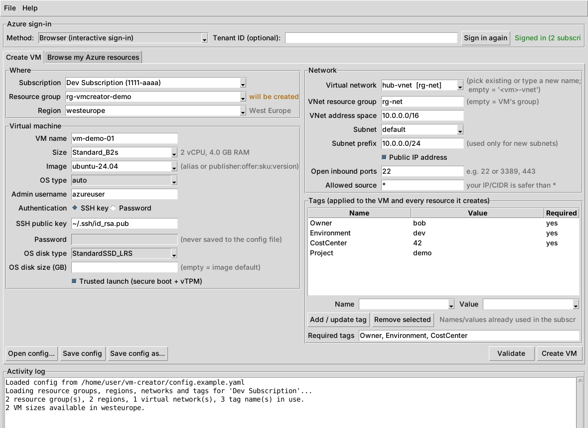
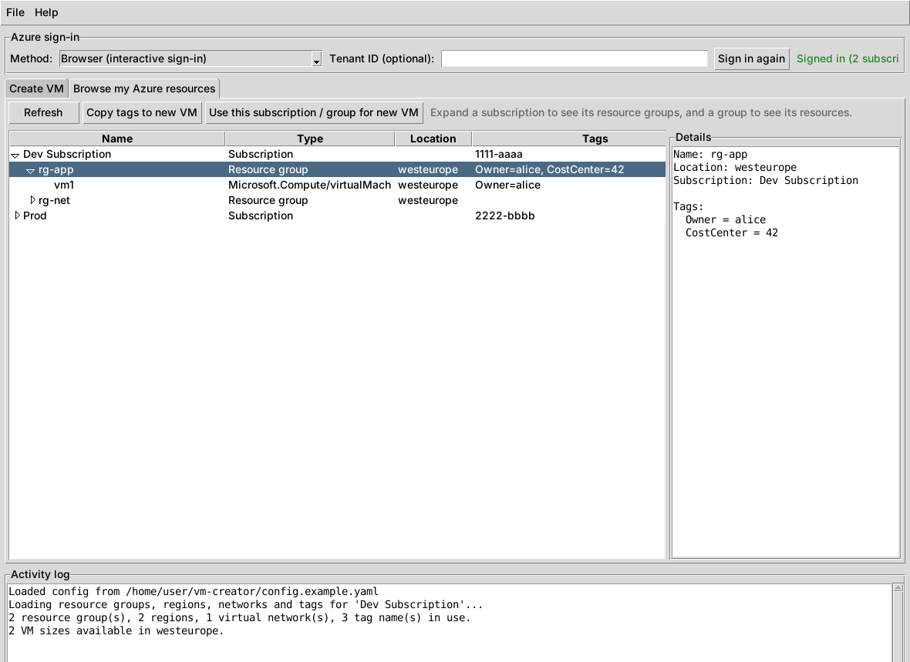

# Azure VM Creator

A small desktop app for creating **tagged** Azure virtual machines. You can
use it in three ways:

- **GUI.** Sign in, pick from the subscriptions, resource groups, regions,
  VM sizes and virtual networks you have access to, add tags, then click
  **Create VM**.
- **Config file.** Fill in a YAML file (`config.yaml`). The GUI loads it and
  can save the form back to it.
- **Command line.** `python -m vm_creator create -c config.yaml` creates the
  VM from a config file without opening the GUI. You can use this in scripts.




## What it does

- **Sign-in.** You can sign in three ways: in your browser (the default), by
  reusing an existing Azure CLI `az login`, or with a device code. One sign-in
  covers every directory (tenant) your account belongs to.
- **Browse tab.** Shows all your subscriptions, then their resource groups,
  then the resources inside each group, with each item's tags. From this tab
  you can copy an existing resource's tags into the new VM, or reuse its
  subscription and resource group.
- **Tags:**
  - The tag editor suggests tag names and values that are already used in the
    subscription, so the spelling stays consistent (`CostCenter` vs
    `Cost Center`).
  - You can list **required tags** (`required_tags` in the config). The VM is
    not created until each of them has a value.
  - Tags are checked against Azure's rules: at most 50 tags, no `<>%&\?/` in
    tag names, no reserved prefixes, and no duplicate names (Azure ignores
    case).
  - Tags are applied to everything the tool creates: the resource group and
    VNet (only if they are new), the NSG, public IP, NIC, VM and **OS disk**.
    Azure does not pass the VM's tags on to the OS disk by itself, so the tool
    tags the disk separately.
- **Networking.** You can join an existing VNet and subnet (including one in
  another resource group) or create new ones. A public IP is optional, and you
  can open inbound ports from a source address you choose.
- **Safety:**
  - Before anything is created, the tool shows a preview of what it will
    create and asks you to confirm.
  - Passwords are **never** written to the config file.
  - When you delete the VM, its NIC and OS disk are deleted with it.

## Setup (one time)

### 1. Install Python 3.10 or newer

- **Windows:** download it from <https://www.python.org/downloads/>. In the
  installer, tick **"Add python.exe to PATH"**. Tkinter, the GUI toolkit, is
  included.
- **macOS:** `brew install python python-tk`, or use the python.org installer.
- **Ubuntu/Debian:** `sudo apt install python3 python3-venv python3-tk`

### 2. Get the code and start it

**Windows:** double-click `run_gui.bat`. The first run creates a `.venv`
folder and installs the dependencies. This takes about a minute.

**macOS / Linux:** `./run_gui.sh`

**Manual setup** (any OS):

```bash
python -m venv .venv
.venv\Scripts\activate          # Windows
source .venv/bin/activate       # macOS / Linux
pip install -r requirements.txt
python -m vm_creator            # opens the GUI
```

### 3. Things you may or may not need

| Thing | Needed? |
|---|---|
| **Azure CLI** (`az`) | **No.** The default "Browser" sign-in works without it. Install it only if you want the "Azure CLI" sign-in method: <https://learn.microsoft.com/cli/azure/install-azure-cli>, then run `az login` once. |
| **Azure permissions** | Yes. You need **Contributor** (or *Virtual Machine Contributor* plus *Network Contributor*) on the subscription or resource group. Creating new resource groups requires Contributor on the subscription. |
| **SSH key** (Linux VMs) | Recommended. If you don't have one, create it with `ssh-keygen -t ed25519` (built into Windows 10/11, macOS and Linux). Then point the GUI to `~/.ssh/id_ed25519.pub`. |
| **App registration / service principal** | No. You sign in as yourself. |

## Using the GUI

1. Optionally copy `config.example.yaml` to `config.yaml` and fill in your
   defaults (especially `tags` and `required_tags`). The GUI loads
   `config.yaml` from the current folder automatically. You can open other
   files with **Open config...**.
2. Click **Sign in**. A browser window opens for the Microsoft login. If
   your account is in several directories and one doesn't show up, enter its
   **Tenant ID** before signing in.
3. Pick the **subscription**. The tool then loads your resource groups,
   regions, VNets and existing tag names. Next, pick a **region**, which loads
   the VM sizes available there.
4. Fill in the VM details:
   - The **Resource group** box shows *existing* or *will be created* next to
     the name.
   - Leave **Virtual network** empty to create `<vm>-vnet`, or pick an
     existing one.
5. Add **tags**:
   - Choose or type a name and a value, then click **Add / update tag**.
   - Required tags already appear in the list. Fill in their values.
6. Click **Validate**, then **Create VM**. Check the preview and confirm.
   Progress appears in the activity log. When it finishes, the tool shows the
   public IP and the `ssh` or `mstsc` command to connect.
7. Optionally click **Save config** to keep the form as a reusable config
   file.

## Config file & command line

See [`config.example.yaml`](config.example.yaml). Every field is commented
there.

```bash
python -m vm_creator validate -c config.yaml      # offline check + preview, no Azure calls
python -m vm_creator create   -c config.yaml      # sign in and create (asks to confirm)
python -m vm_creator create   -c config.yaml -y --auth device_code   # unattended-ish, no browser
python -m vm_creator list     -c config.yaml      # list subscriptions, resource groups and tag names
```

For Windows VMs (or Linux with password auth), you have two options:

- Let the CLI prompt you for the password.
- Set the `AZURE_VM_ADMIN_PASSWORD` environment variable, so nothing sensitive
  goes into the YAML file.

Images: use an alias (`ubuntu-24.04`, `ubuntu-22.04`, `debian-12`, `rhel-9`,
`windows-server-2025`, `windows-server-2022`, `windows-server-2019`) or any
marketplace URN `publisher:offer:sku:version`. Run `az vm image list --all`
or check the portal to find a URN. For a custom URN that isn't obviously
Windows or Linux, set `vm.os_type`.

## Troubleshooting

- **Sign-in works but no subscriptions are listed:**
  - Enter your Tenant ID (Azure portal → *Microsoft Entra ID* → *Overview*)
    and sign in again.
  - Some directories require MFA. The log lists any directories that were
    skipped.
- **`SkuNotAvailable` / quota errors:** that VM size is not available in the
  region, or your subscription's vCPU quota is used up. Try another size or
  region.
- **Trusted launch error:** a few older sizes and Gen1 images don't support
  it. Untick *Trusted launch*.
- **"No module named tkinter"** (Linux): run `sudo apt install python3-tk`.

## Development

```bash
pip install -r requirements.txt pytest
python -m pytest
```

The modules in `vm_creator/`:

| Module | Contents |
|---|---|
| `config.py` | Config model and validation |
| `images.py` | Image aliases |
| `azure_ops.py` | All Azure calls |
| `gui.py` | Tkinter UI |
| `cli.py` | Command line |
